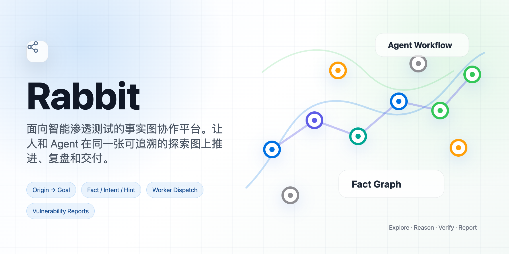
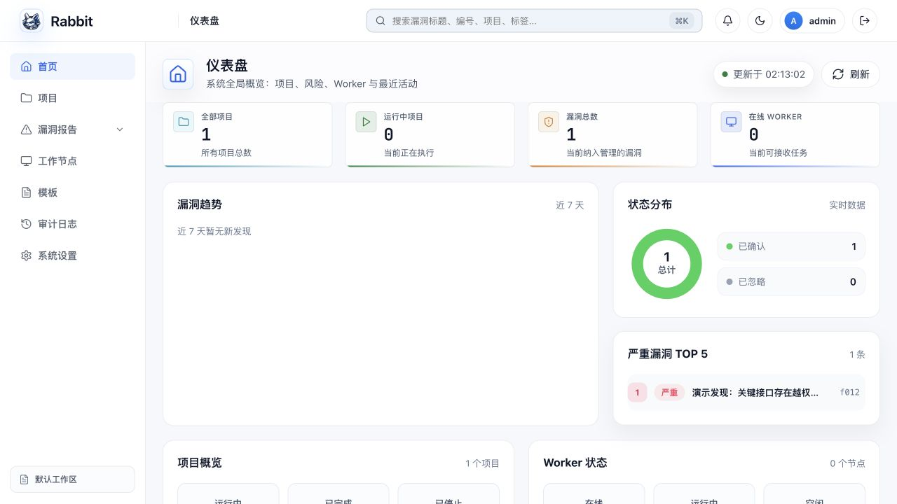
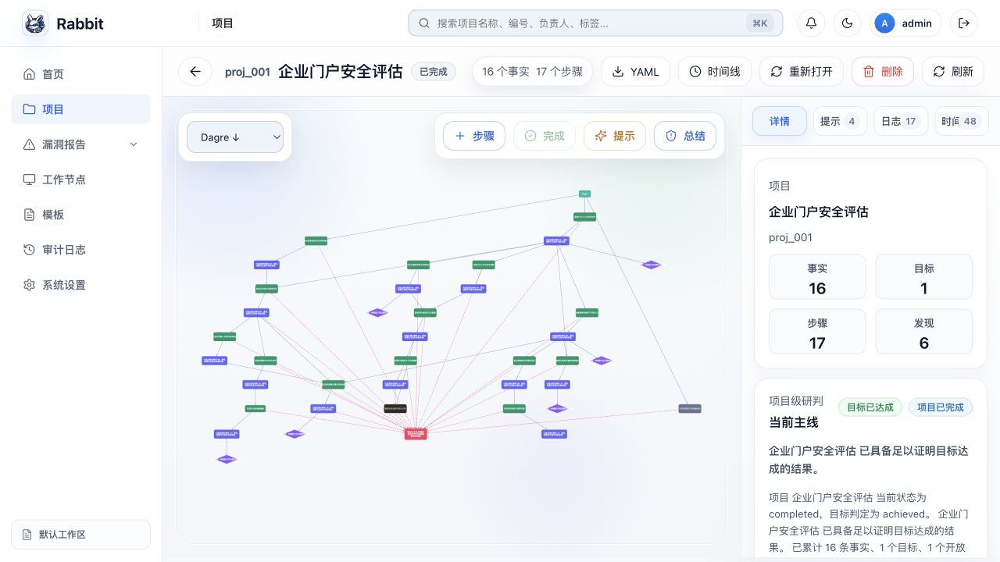
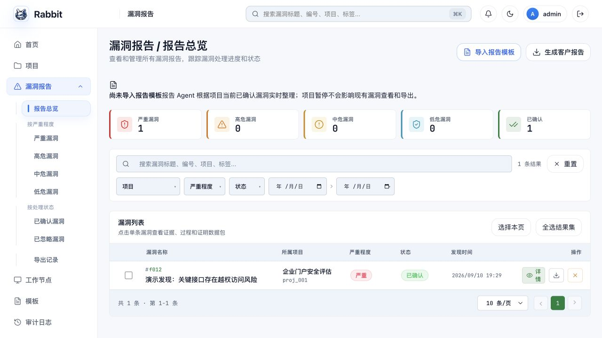
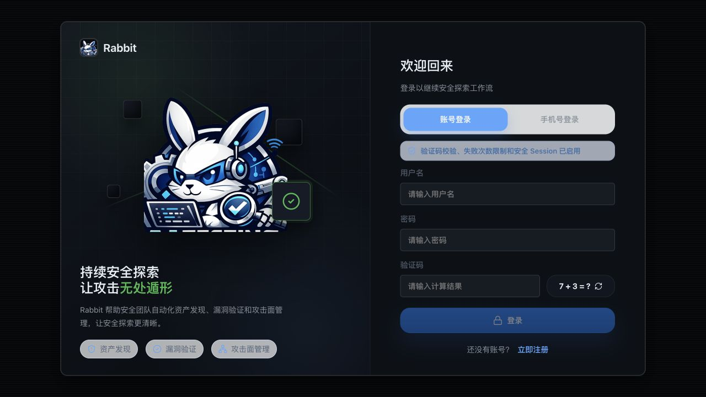
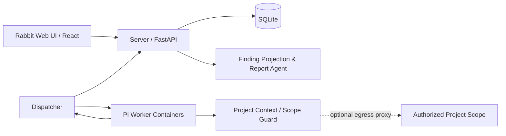

# Rabbit（Cairn-Y）



Rabbit 是一个面向授权安全评估的多 Agent 协作平台。它基于 [oritera/Cairn](https://github.com/oritera/Cairn) 的事实图思想演进，将自动化探索收敛成一条可验证、可追踪、可交付的执行闭环：**Server 保存唯一状态，Dispatcher 负责任务调度，Pi Worker 执行 Decide / Execute，结果写回 Fact，确认的问题以 Finding 作为唯一真相源。**

项目目录和 Python CLI 保留 `cairn` 名称以兼容原工程结构，产品界面使用 Rabbit。

> ⚠️ **Rabbit 仅用于已获得明确授权的安全测试、内部验证和研究环境。** 使用前请阅读文末[免责声明](#免责声明)；范围约束约定见 [AUTHORIZED_SECURITY_SCOPE.md](AUTHORIZED_SECURITY_SCOPE.md)。

## 产品预览

### 全局仪表盘



### 事实图项目工作台



### 漏洞报告与交付



<details>
<summary>查看登录页面</summary>



</details>

## Cairn-Y 核心模型

```text
Origin
  └─ Goal
      └─ Decide（串行决策，只创建/调整 Step）
          └─ Step
              └─ Execute（并行执行）
                  ├─ Fact
                  └─ Finding（可选，必须关联 Fact）
```

- **Server**：唯一状态真相源，维护 Project、Goal、Step、Fact 和 Finding。
- **Dispatcher**：负责项目生命周期、串行 Decide、并行 Execute、Worker 调度、租约、心跳和超时。
- **Pi Worker**：通用执行单元；当前运行配置只注册 Pi，不保留第二套执行内核。
- **Fact**：执行阶段确认的客观结果；Step 无论成功、失败还是未发现问题，最终都收敛为 Fact。
- **Finding**：Execute 原生输出的结构化发现，是报告系统唯一允许使用的发现来源。
- **Vulnerability**：Finding 面向界面和导出格式的投影，不是第二套漏洞数据源。
- **报告 Agent**：只整理已有 Finding 的表达和证据，不从 Fact 猜测漏洞、不新增漏洞、不改变严重度。

## 架构



运行时只有三类任务：

1. `decide`：读取当前 FGS 状态，创建下一批 Step；同一项目始终串行。
2. `execute`：执行一个 Step，输出 Fact 描述和可选 Finding；允许并行。
3. `execute_conclude`：将结果原子写回 Server，结束 Step 并建立来源关系。

## v1.0 执行层增强

v1.0 将执行核心与 Cairn-Y 完全对齐，重点解决"长实验被切断、失败后从零重来"的收敛问题：

| 能力 | 说明 |
|---|---|
| **有界步骤提示词** | decide/execute/conclude 三段提示词内置边界约束：一步回答一个可验证的问题、确认即停、不为穷尽而穷尽，前置未确认不开工。 |
| **step_recovery 会话恢复** | 执行超时或解析失败后进入 `summary_pending` / `commit_pending` 状态机，重试时**不重新执行原动作**，只补摘要或重放提交；恢复失败升级为 `needs_attention` 并禁止自动重跑，等待人工检查。 |
| **严格输出解析与修复环** | fail-closed 的 JSON 解析（重复键、围栏、尾部残渣一律拒绝），失败后带语法诊断的定向修复重试，修复不通过才判定失败。 |
| **工具超时扩展** | Pi bash 工具单次调用默认 90 秒上限（`CAIRN_BASH_TIMEOUT_SECONDS` 可调），防止单条命令耗尽整步预算。 |
| **JDK 工具链** | Worker 镜像内置 JDK，`jdb` / `javap` 开箱即用，Java 调试协议（JDWP）类目标无需手写协议实现。 |
| **600 秒执行预算** | 每步 600s（探索 540s + 收尾预留 60s）+ 独立 90s 收尾预算，长利用链（协议交互、多阶段验证）可以一步完成。 |

同时，Hint（操作员提示）会随每个新阶段注入 Worker 上下文：提示可以是证据、建议、修正或明确约束，由 Agent 按内容解读，不覆盖更高优先级的指令。

## 当前能力

- **统一工作台**：仪表盘、项目、漏洞报告、Worker、模板、审计日志和系统设置集中管理。
- **事实图探索**：以 Goal / Step / Fact / Finding 构建可视化关系图，保留来源、时间线和执行日志。
- **单循环 Agent 架构**：Decide 串行决策，Execute 并行执行，conclude 原子回写，避免双状态源。
- **执行可靠性**：有界提示词、会话恢复、严格解析修复环与工具超时控制（见上文 v1.0 执行层增强）。
- **隔离 Worker**：容器化 Pi Worker、并发控制、租约、心跳、超时、启动健康检查和故障切换。
- **范围与出站约束**：项目上下文和 Scope Guard 约束目标边界；需要强制网络层控制时可启用出站代理。
- **Finding 驱动报告**：漏洞视图只投影已关联真实 Fact 的 Finding，不从普通执行日志猜测漏洞。
- **交付链路**：漏洞筛选、状态管理、证据截图、报告 Agent、导出记录以及 Markdown / PDF / DOCX 等格式导出。
- **客户模板**：导入并启用 DOCX 模板，将结构化发现和证据图片填充到客户报告。
- **运营与审计**：全局统计、风险趋势、通知、操作审计、数据保留策略和系统健康检查。
- **身份安全**：注册开关、算术验证码、失败次数限制、bcrypt 密码哈希和服务端 Session。

## 快速启动

完整的首次安装、升级、备份和故障排查见 [安装与升级](INSTALL.md)。

需要 Docker Engine/Desktop、Compose v2，以及可用的 OpenAI-compatible 模型接口。

```bash
git clone https://github.com/Rabbit0007/Rabbit.git
cd Rabbit
git checkout v1.0
cp .env.example .env
cp dispatch.yaml dispatch.local.yaml
```

在 `.env` 填入三个服务令牌：

```dotenv
CAIRN_INTERNAL_TOKEN=replace-with-random-value
CAIRN_DISPATCHER_INTERNAL_TOKEN=replace-with-another-random-value
CAIRN_WORKER_EGRESS_PROXY_TOKEN=replace-with-another-random-value
```

在 `dispatch.local.yaml` 的 `PI_API_KEY` 填入模型密钥，保持该文件仅在本机；当前模板注册 4 个 GLM-5.3 Pi Worker，并使用：

```text
Model: glm-5.3
Base URL: https://open.bigmodel.cn/api/coding/paas/v4
Provider API: openai-completions
```

如需其他模型，只修改本机的 `dispatch.local.yaml`。该文件已被 Git 忽略，不要把真实密钥写入公开的 `dispatch.yaml` 模板。`TSEC_SERVER_HOST` 如与本机容器网络不符，也需在本地配置中调整。

构建 Worker 镜像（v1.0 起内置 JDK，提供 `jdb`/`javap`）并启动：

```bash
docker build --platform linux/amd64 -f container/Dockerfile.pi -t rabbit-pentest-worker:pi-0.84.4-jdk .
docker compose up -d --build
docker compose ps
```

打开 `http://127.0.0.1:8000/`，首次启动后在登录页注册账号。停止服务：

```bash
docker compose down
```

数据库保存在 `./datas/cairn/`，报告证据保存在 Docker volume `rabbit-pentest-artifacts`。服务默认只绑定 `127.0.0.1:8000`。前端在 Docker 构建过程中自动构建，无需预先执行 npm 命令。

> 修改 `dispatch.local.yaml` 后需要 `docker compose up -d --force-recreate pentest-dispatcher` 才会生效：它是单文件 bind mount，普通 `restart` 不会重新加载。

## 默认 Worker 并发

仓库模板默认注册 4 个同模型 Pi Worker；调度并发上限为 4：

```text
glm-5.3-1 ... glm-5.3-4
```

默认调度约束：

```yaml
runtime:
  max_workers: 4
  max_running_projects: 1
  max_project_workers: 4

tasks:
  decide:
    max_steps: 3
  execute:
    timeout: 600                # 每步执行预算（v1.0 关键配置）
    conclude_timeout: 90
    conclude_reserve_seconds: 60
```

这样一次只运行一个项目，最多使用 4 个并发调度槽。Decide 始终串行，不会出现多个决策器同时修改 FGS。

## 报告生成

报告链路只有一条：

```text
Decide 创建 Step
→ Pi Execute 返回 description + optional finding
→ conclude 原子创建 Fact 并结束 Step
→ 合法 Finding 与 Fact 关联写入
→ Finding 投影为漏洞视图
→ 报告 Agent 整理已有 Finding
→ UI 展示或导出
```

进入漏洞报告的 Finding 必须满足：

- `kind` 为 `security_vulnerability` 或 `vulnerability`
- `severity` 为 `critical`、`high`、`medium` 或 `low`
- 关联真实 `fact_id`

只有 Fact、没有 Finding 的执行结果不会进入漏洞报告。

报告只使用已记录的 Finding 和关联证据，不从普通执行日志推断漏洞。

## 开发与测试

后端测试：

```bash
cd cairn
uv sync
uv run --with pytest --with httpx python -m pytest
```

前端构建：

```bash
cd cairn/frontend
npm install
npm run build
```

只启动本地 Server：

```bash
cd cairn
uv run cairn serve --host 127.0.0.1 --port 8765 --log-level info
```

常用检查：

```bash
docker compose ps
curl -sS -o /dev/null -w '%{http_code}\n' http://127.0.0.1:8000/
```

## 目录结构

```text
.
├── cairn/
│   ├── frontend/                         # Web UI
│   ├── src/cairn/dispatcher/             # 调度、任务和 Pi Worker 适配
│   ├── src/cairn/server/                 # API、认证、状态、Finding 和报告
│   └── tests/                            # 后端与 Cairn-Y 核心测试
├── container/                            # Worker 容器（Dockerfile.pi 内置 JDK）
├── docs/specs/                           # 协议与调度设计
├── .rabbit/context/                      # 可复用项目上下文模板
├── dispatch.yaml                         # 默认 Pi Worker 配置（占位符模板）
├── docker-compose.yaml                   # 完整运行环境
└── .env.example                          # 环境变量模板
```

## 设计与验证文档

- [版本变更记录](CHANGELOG.md)
- [Cairn-Y 实现总结](cairn/CAIRN_Y_SUMMARY.md)
- [测试报告](cairn/TEST_REPORT.md)
- [Server 协议](docs/specs/server-protocol.md)
- [Dispatcher 设计](docs/specs/dispatcher-design.md)

## 免责声明

**本项目仅面向获得明确授权的安全测试、自有资产验证、教学研究与实验环境。**

1. **授权前提**：使用者必须在使用本工具对任何目标进行测试之前，获得目标资产所有者（或其合法授权方）的书面授权。在未获授权的情况下对任何计算机信息系统进行渗透测试、漏洞探测或利用，在大多数司法辖区内属于违法行为。
2. **合规责任**：使用者有责任自行了解并遵守所在地的法律法规（包括但不限于《网络安全法》《数据安全法》《刑法》相关条款及所在国同类法律）。因使用或滥用本工具而产生的任何直接或间接法律责任，由使用者自行承担，与本项目作者及贡献者无关。
3. **输出不保证正确**：本工具的发现、结论和报告由大语言模型 Agent 生成，可能存在误报、漏报、过时或不准确的描述。任何 Finding 在被人工复核并验证之前，不应作为事实依据或交付结论使用。
4. **无担保**：本项目按"现状"（AS IS）提供，不提供任何明示或默示的担保，包括但不限于适销性、特定用途适用性和不侵权。详见 [LICENSE](LICENSE)（AGPL-3.0）第 15、16 条。
5. **禁止用途**：不得将本工具用于破坏性操作、拒绝服务、持久化控制未授权资产、横向扩散、供应链攻击或其他任何危害他人系统与数据的行为。
6. **后果自担**：下载、复制或使用本工具即视为已阅读、理解并同意本免责声明的全部条款。不同意请立即停止使用并删除本工具。

## 致谢

Rabbit/Cairn-Y 基于 [oritera/Cairn](https://github.com/oritera/Cairn) 的事实图协作思想继续演进。感谢原项目对 Fact 图谱、Agent 协作和自动化探索方向的开源贡献。

## License

本项目遵循仓库中的 [AGPL-3.0 License](LICENSE)。
