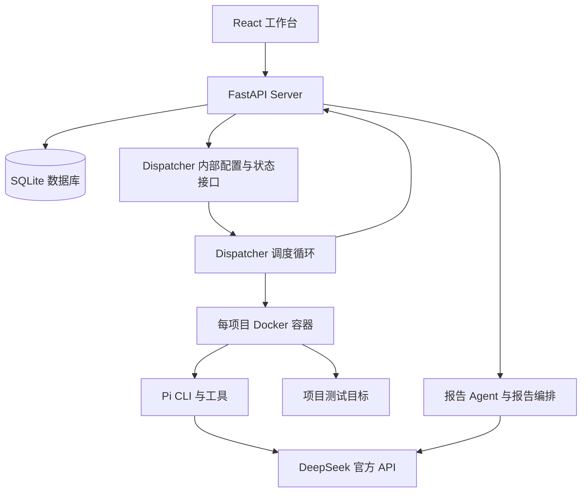

# Rabbit 系统说明与代码导航

核对日期：2026-09-30（§3 镜像构建说明于 2026-10-10 按当前 Dockerfile 修正）。对象：`/Users/rabbit/Desktop/Rabbit`，服务入口 `http://127.0.0.1:8000/`。

本文依据当前源码、运行容器、只读数据库统计和 Dispatcher 状态编写。文档中的运行统计是本次观察快照，不是固定业务配置。本次未启动新的测试项目、未重新执行完整测试套件、未进行逐行安全审计，也未修改业务代码。本文不包含 API Key、会话 Token 或目标详细数据。

## 1. 系统定位

Rabbit 是以事实图为核心的目标导向 Agent 协作平台，当前主要产品场景是授权安全评估。产品层包括项目工作台、漏洞交付、Worker 管理、模板、通知、审计记录和系统设置。

当前执行模型是 Cairn-Y：Fact、Goal、Step、Finding。它将计划、执行结果和可交付发现拆成不同对象，并通过来源关系串联。`cairn` 仍是 Python 包、CLI 和内部路径名称，Rabbit 是产品名称。

## 2. 架构和职责

| 层 | 职责 | 主要入口 |
| --- | --- | --- |
| 前端 | 登录、项目图、节点详情、漏洞筛选与交付、Worker 配置 | `cairn/frontend/src/App.jsx` |
| Server | 持久化业务对象、协议校验、事务、身份认证、产品 API | `cairn/src/cairn/server/app.py` |
| Dispatcher | 轮询项目、选择 Worker、获取租约、执行、取消、退避与清理 | `cairn/src/cairn/dispatcher/scheduler/loop.py` |
| Worker Driver | 将任务转为 Agent CLI 调用，适配模型及会话，解析输出 | `cairn/src/cairn/dispatcher/workers/adapters/` |
| Runtime | 容器/本地进程、超时、心跳、进程管理 | `cairn/src/cairn/dispatcher/runtime/` |
| 报告层 | Finding 投影、已有证据整理、标准导出、客户模板填充 | `cairn/src/cairn/server/report_*` |

Server 保存持久化业务状态；Dispatcher 的 Future、检查点、Worker 冷却状态和近期任务历史属于调度运行状态。Worker 返回结构化结果，常规执行链由 Dispatcher 调用 Server 写回。

## 3. 技术栈与构建

- 后端：Python 包要求 Python >= 3.12；当前 Dockerfile 基于 Python 3.13，使用 uv、FastAPI、Uvicorn、Pydantic、SQLite、Docker SDK。
- 前端：React 19、Vite 6、Lucide React；事实图使用 Cytoscape 和布局扩展。
- 报告：python-docx，以及后端实现的 JSON、CSV、Markdown、PDF、DOCX 导出逻辑。
- 前端构建输出默认写入 `cairn/src/cairn/server/static/`，由 FastAPI `/static` 提供，首页返回该目录的 `index.html`。
- 根 Dockerfile 使用多阶段构建：镜像构建内执行 `npm ci` 和 `npm run build` 生成前端静态资源，无需在宿主机预装 Node。前端源码修改后直接 `docker compose up -d --build` 重建镜像即可。
- 普通源码并未挂载到运行容器。仅修改本地 Python 文件不会自动改变当前镜像中的服务代码，需要重建镜像后生效。

## 4. 数据模型

| 对象 | 含义 | 关键关系/字段 |
| --- | --- | --- |
| Project | 一次完整任务 | `active / stopped / completed`，项目级 Decide 租约 |
| Fact | 已写回的执行结果或确认信息 | 项目内 ID、description；初始节点名为 `origin` |
| Goal | 完成条件和子目标 | parent_goal_id、priority、完成说明和证据来源 |
| Step | 一条具体探索方向 | 多个来源 Fact、goal_id、priority、worker、to_fact_id、abandoned |
| Finding | 可独立收集的结构化发现 | kind、severity、data、fact_id |
| Hint | 人工补充或方向提示 | content、creator、created_at；不等同于确认事实 |
| Vulnerability | 面向漏洞页面和报告的投影 | 关联 Finding、Fact、产生它的 Step、证据和审核状态 |

核心表是 `projects / facts / goals / steps / step_sources / goal_sources / findings / hints`。产品和认证表也位于同一个 SQLite 数据库，包括用户、会话、漏洞投影、模板、报告附件、审计记录和通知。

`db.get_conn()` 使用 WAL、启用外键，并在成功时提交、异常时回滚。Step conclude 在一个事务中创建 Fact、结束 Step、创建可选 Finding 并同步漏洞投影。

Fact 的结构本身不包含独立时间戳，执行时序主要依赖关联 Step 和其他记录。Goal 已从旧版特殊 Fact 中分离出来。

`Intent = Step`、旧 reason 接口以及旧配置名称仍有兼容层。数据库初始化包含旧 Intent 到 Step、旧 Goal Fact 到 Goal 的迁移，旧任务名称在配置加载时转换为 decide/execute。

## 5. 一次任务如何运行

1. 用户创建项目，提交 title、origin、goal 和可选 hints。
2. Server 创建 Project、`origin` Fact、顶层 Goal，并生成项目上下文文件。
3. Dispatcher 每轮读取活跃项目，并受全局、项目、Worker 三层并发限制。
4. 初始项目先运行 Decide；图谱变化、新增 Hint、目标变化或待执行 Step 消耗完也可能触发 Decide。
5. Dispatcher 先获取项目级 Decide 租约，再派发模型。Decide 可以创建 Step、调整未认领 Step 的优先级、放弃 Step、管理子目标，或依据现有 Fact 完成一个 Goal。
6. Decide 租约存在期间，不启动新的 Execute claim；它不代表已经运行中的 Execute 都会停止。
7. 未认领 Step 按 priority 从高到低、创建时间从早到晚排序。Dispatcher 通过 Step heartbeat 接口取得租约，然后派发 Execute。
8. Execute 读取完整图谱快照和当前 Step，调用工具执行，返回 description 和可选 finding。
9. Dispatcher 校验输出，通过 conclude 将结果原子写回 Server；图谱变化再触发后续 Decide。
10. 当前所有 Goal 完成后，项目切换为 completed，Dispatcher 取消不再需要的任务并清理项目容器。

决定与执行的协议输出分别校验：Execute 不能通过输出额外字段直接修改 Goal。Decide 在写入前检查 Fact 引用、Goal 状态以及 Step 是否已关闭或已认领。

协议校验确认结构和引用有效，并不自动证明模型所写的事实在现实中正确。业务证据质量仍取决于实际执行与结果审查。

### 完成条件的实际语义

当前 Server 的完成判定检查所有 Goal 是否 completed，不检查所有 Step 是否已经收敛。完成时可能还保留开放 Step；这些 Step 不会因为项目完成而自动生成结论 Fact。

本次数据库确实存在这种情况：17 个 Step 中，15 个已结论、1 个 abandoned、1 个仍开放，但项目已 completed。这与部分文档中的“没有未收敛 Step 后才完成”描述不同。

## 6. Worker 和执行环境

Worker 是配置中的逻辑执行单元，不是每个 Worker 一个长期独立容器。当前容器后端为每个项目创建一个容器，多个 Worker 可在该项目容器中执行不同进程。

代码注册了 Pi、Codex、Claude Code、Mock 四种 Driver，以及 container/local 两种执行模式；当前部署只启用 4 个 Pi Worker，使用 container 模式。

Pi 的具体行为：

- Decide 只启用 `read` 工具；Execute 和 conclude 启用 read/write/edit/bash/grep/find/ls。
- Dispatcher 把图谱写为容器中的独立 YAML 文件，提示模型读取这个文件，而不是将整张图直接放入命令参数。
- 每个 Worker 有独立的 Pi 配置/会话目录：`/tmp/cairn-pi/{worker_name}`。
- 自定义 provider 名为 `cairn`，实际模型、Base URL、Key 和 provider API 来自 Worker.env。
- CLI 使用 `--no-skills`、`--no-context-files` 等参数。宿主机 Codex skills、全局 rules 和项目 AGENTS.md 不会因此自动进入 Rabbit 的 Pi 模型上下文。
- 每次普通任务使用准备出的会话；Execute 超时或输出解析失败时，有条件在同一会话进入 execute_conclude 收尾阶段。

因此，多个 Worker 的协作主要通过 Server 上的共享事实图实现，不依赖它们拥有同一个模型对话。

## 7. 调度、超时和恢复

| 配置 | 当前值 | 解释 |
| --- | --- | --- |
| max_workers | 4 | 全局同时运行的调度任务上限 |
| max_running_projects | 1 | 同时推进的项目上限 |
| max_project_workers | 3 | 单项目同时运行任务上限，包含 Decide |
| Worker max_running | 1 | 每个逻辑 Worker 同时执行一个任务 |
| interval | 3 秒 | 调度轮询间隔，也是心跳周期的相关输入 |
| decide.timeout | 300 秒 | Decide 命令执行超时 |
| execute.timeout | 300 秒 | Execute 主阶段超时 |
| execute.conclude_timeout | 90 秒 | 执行收尾阶段超时 |
| healthcheck_timeout | 60 秒 | 模型连接健康检查超时 |
| worker_healthcheck | startup_only | 默认配置：启动阶段健康检查 |
| Server step_timeout / decide_timeout | 15 秒 | 心跳租约过期阈值，不是模型任务总时长 |

Worker 选择先过滤禁用、任务类型不匹配、并发满、健康冷却、拒绝冷却和失败退避，再按 priority 较小者优先、当前负载较小者优先、随机打破平局。

注意 Step 的 priority 越大越优先，而 Worker 的 priority 越小越优先。

任务失败有按项目/任务类型/Worker 记录的指数退避。租约失效、项目停止/完成/删除会影响后续执行；正常结论写回后不依靠容器内的自由文本维持状态。

项目容器使用命名空间 `rabbit-pentest-dispatch-`，当前 completed_action 为 stop，完成后停止并保留容器，而非直接删除其文件系统。

## 8. Finding、漏洞列表和报告

漏洞投影的入口是 `finding_projection.py`，当前只接受：

1. kind 为 `security_vulnerability` 或 `vulnerability`。
2. severity 为 critical/high/medium/low。
3. 存在关联 fact_id。

Finding.kind 是自由字符串，Execute 合约允许其他 kind；它们可以作为通用发现保存，但不会自动变成漏洞报告。

本次 6 个 Finding 的分布是：security_vulnerability/critical 1 个、information_disclosure/medium 2 个、broken_access_control/medium 1 个、vulnerability_research/info 1 个、vulnerability_research/medium 1 个。因此目前漏洞投影只有 1 个。这是分类契约导致的过滤，不表示其他记录被删除。

报告链路分为三层：

- 确定性投影：Finding 生成漏洞页面数据、来源 Step、证据 Fact 和流程信息。
- 后台报告 Agent：每 5 秒扫描 active 项目的结构化安全 Finding，按输入指纹避免重复整理，增强写入 Finding.data.report_enrichment；不创建新 Finding、不修改 severity。
- 报告编排/模板：单条漏洞叙述、标准格式导出，以及客户 DOCX 模板解析和填充。

报告模型可由专用 `CAIRN_REPORT_COMPOSER_*` 配置覆盖；否则从启用的 Pi Worker 配置中选取。本次运行解析结果同样为 `deepseek-flash`，Base URL 为 `https://api.deepseek.com/v1`。

标准漏洞导出支持 JSON、CSV、Markdown、PDF、DOCX。客户 DOCX 模板是另一条导出路径，输入仍来自已确认漏洞投影和上传的证据。

截图上传 API 将 PNG/JPEG 内容、文件名、MIME、SHA-256 等存入 `report_evidence_artifacts` 的数据库记录。报告模板内容也保存在数据库。不能只根据 Compose 里的 artifacts volume 判断报告附件的实际存储位置。

现有报告证明包路径读取已经保存的 proof_packets；源码还存在基于事实重构请求的辅助函数，但不应把该函数的存在理解为系统已自动抓取所有原始 HTTP 包。

## 9. 前端工作台

当前主要页面和交互集中在约 6600 行的 `App.jsx` 中，API 请求封装位于 `api.js`。路由使用 URL hash，主要包括 dashboard、projects、project workspace、vulnerabilities、workers、templates 和 audit。

| 页面/模块 | 主要功能 |
| --- | --- |
| Dashboard | 项目、Worker 和漏洞统计，风险趋势及跳转 |
| Projects | 创建、搜索、筛选、分页、停止、恢复、完成后重开 |
| ProjectWorkspace | 图谱、布局切换、节点 Inspector、时间线、项目态势、人工 Hint/Step 操作 |
| Vulnerabilities | 筛选、详情、证据、确认/忽略状态、批量操作和导出 |
| Workers | 运行状态、观测信息、任务历史、配置编辑、连接测试 |
| Templates | 内置项目模板和按用户保存的自定义项目模板 |
| Settings | 租约阈值、认证策略、保留策略、健康检查与清理 |
| Audit/Notifications | 操作记录、消息和未读状态 |

项目工作台使用 5 秒轮询，Dashboard 使用 8 秒轮询，审计页使用 10 秒轮询。当前不是依赖 WebSocket 的统一实时推送架构。

Campaign 汇总服务根据图谱和漏洞投影计算目标态势、关键发现、阻塞项与下一步建议，其中一些汇总使用规则/文本打分。它不负责执行动作，也不替代核心 Finding 真相源。

## 10. 配置保存和热更新

Worker 编辑框对应如下链路：

`WorkerEditor -> PUT /api/workers/config -> PUT /internal/workers/config -> 校验配置 -> 写 dispatch.yaml -> 更新 Dispatcher 配置`

Server 负责代理内部请求并记录产品层操作信息。Dispatcher 验证及写入失败时保留原配置。API 返回 Key 的掩码，提交原掩码会保留真实 Key。

内部配置写回会将与进程环境变量中已知 secret 相同的值重新映射为 `${VAR}`。本次按用户要求将 Key 直接保存为 Worker.env.PI_API_KEY，并移除了此前新增的 `.env` 项，因此后续保存保留直接值，不再依赖该 env 引用。

`dispatch.yaml` 在 Server 和 Dispatcher 中是单文件 bind mount。配置写回针对 Docker mount 无法 rename 的情况实现了原地写入回退。

当前 Worker 名称仍为 `deepseek-v4-flash-ga-1` 到 `-4`，但 PI_MODEL 已是 `deepseek-flash`；name 是调度标识，不能用旧名称判断实际模型。

## 11. 身份与上下文的实现边界

浏览器认证使用服务端 Session 和 HttpOnly Cookie，密码使用 bcrypt；登录包含验证码和失败次数限制。服务间使用内部 Token，Server 和 Dispatcher 内部 API 的认证 Header 名称不同。

当前项目表和主要项目路由未体现项目级 owner/成员隔离，整体更接近共享工作台。自定义项目模板则按用户隔离。不能将“有登录”直接等同于完整的多租户 RBAC。

`.rabbit/context/default.project-context.yaml` 和项目覆盖文件有命名、创建和解析辅助代码。但当前 Decide/Execute 提示词构建和 YAML 导出主路径未发现调用该上下文加载器；不能认为文件中的所有规则已经自动进入每次模型调用。

当前 `build_scope_policy()` 返回空 project_context/scope_policy/user_assertions。Step 创建路由也未调用 scope_guard；现存文件名不能直接证明这条主路径启用了完整范围过滤。

出站代理服务正在运行，但当前 Worker 使用 host network，Dispatcher 的代理 URL/Token 环境配置为空，ContainerManager 创建项目容器时未注入代理链路。因此当前部署不应被描述为所有 Worker 流量均经过强制出站代理。

以上记录用于明确当前行为，不是本次安全审计结论。

## 12. 本次运行快照

- 三个 Rabbit 服务均运行；Server 与 egress-proxy 健康；入口绑定 `127.0.0.1:8000`。
- 四个 Pi Worker 均启用、idle、没有处于 unhealthy 冷却；运行任务与运行项目数量为 0。
- 使用 `deepseek-flash`、`https://api.deepseek.com/v1`、`openai-completions`；报告模型解析与之相同。
- 数据库位于宿主机 `datas/cairn/cairn.db`，容器内对应 `/root/.local/share/cairn/cairn.db`；当前为 WAL。
- 项目 1 个，状态 completed；Fact 16、Goal 1、Step 17、Finding 6、漏洞投影 1。
- 用户 3；自定义项目模板、客户报告模板、报告截图附件均为 0。数据库模板为 0 不代表系统没有内置项目模板。
- worker_task_history 表为 0。Dispatcher 有有界内存历史，Server 有持久表查询，但本次源码搜索未发现生产路径向该表 INSERT 的实现；不能把当前历史能力视作已证明的完整持久化执行审计。
- 抽查 scheduler/loop.py、server/app.py、dispatcher/internal_api.py、Pi adapter、静态 index.html：宿主机与运行镜像的 SHA-256 一致。此结论只覆盖所核对的文件。

## 13. 文档差异和后续工作导航

`README.md` 和 `cairn/CAIRN_Y_SUMMARY.md` 的核心模型更接近当前代码；`docs/specs/server-protocol.md` 和 `dispatcher-design.md` 仍包含旧版 Intent、bootstrap/reason/explore 内容。旧部署模型名、空库统计和上下文自动注入等描述也不能替代当前运行检查。

后续改动定位：

| 需求 | 优先阅读/修改 |
| --- | --- |
| 决策质量、探索维度、结果输出 | `dispatcher/prompts/default/`、`dispatcher/contracts.py`、`dispatcher/tasks/` |
| 调度、重复执行、并发和重试 | `dispatcher/scheduler/loop.py`、`runtime/heartbeat.py`、`server/services.py` |
| 模型切换、Worker 热更新 | `dispatch.yaml`、`dispatcher/config.py`、`dispatcher/internal_api.py`、`server/routers/workers.py` |
| 漏洞遗漏、分类和证据来源 | `server/finding_projection.py`、`server/routers/steps.py`、`server/routers/vulnerabilities.py` |
| 报告措辞、模型选择和客户模板 | `report_agent_service.py`、`report_composer_service.py`、`report_template_service.py` |
| 项目图、Inspector、页面交互 | `frontend/src/App.jsx`、`styles.css`、`api.js` |
| 上下文与范围接入 | `project_context_files.py`、`project_scope.py`、`scope_guard.py`、`egress_proxy.py`、容器创建路径 |
| 历史、通知和健康观测 | `server/routers/workers.py`、`activity_service.py`、`server/routers/settings.py` |

测试目录已有核心协议、调度、Mock 端到端、取消/超时、配置保存、身份认证、Finding 投影、报告模板等覆盖。本次只阅读相关测试和实现，不将历史测试报告表述为本次测试通过。
